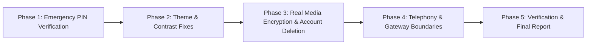

# SvaShield — Prioritized Implementation Plan

> **Project:** SvaShield — Women’s Safety and Emergency Mobile Application  
> **Date:** October 12, 2026  
> **Author:** Senior Full-Stack, Flutter, Android, Spring Boot & Security Architect  
> **Document Path:** `docs/SVASHIELD_IMPLEMENTATION_PLAN.md`  
> **Execution Strategy:** Small, controlled phases with immediate test verification and zero disruption to working functionality.

---

## 1. Executive Implementation Roadmap

Based on the Stage A & B Audit in `docs/SVASHIELD_REQUIREMENTS_AUDIT.md`, the implementation is organized into 5 prioritized phases:

---

## 2. Phase 1 — Emergency Reliability and Security (P0)

### Objectives
Ensure SOS cancellation strictly verifies the user's security PIN both locally on the device and cryptographically on the backend server before closing an emergency alert.

### Target Files
- `safeher-mobile/lib/widgets/security_pin_dialog.dart`: Return the entered PIN string upon confirmation.
- `safeher-mobile/lib/screens/emergency/sos_active_screen.dart`: Pass the entered PIN into `emergencyProvider.endEmergency(pin: enteredPin)`.
- `safeher-backend/src/main/java/com/safeher/emergency/EmergencyService.java`: In `cancelEmergency()`, if `user.getPinHash()` is set and `request.getPin()` is supplied, verify using `passwordEncoder.matches(request.getPin(), user.getPinHash())`. If the user has a configured PIN and an invalid PIN is supplied, throw `BadCredentialsException("Invalid security PIN")`.
- `safeher-backend/src/test/java/com/safeher/emergency/EmergencyServiceTest.java`: Add tests for PIN validation on cancellation.

### Acceptance Criteria
1. Cancelling an SOS in `sos_active_screen.dart` forwards the entered PIN to the backend.
2. The backend rejects cancellation with HTTP 400/401 if an incorrect PIN is submitted for a user with a configured PIN.
3. Successful PIN match transitions the emergency to `CANCELLED`.
4. Existing tests continue to pass (100% pass rate).

---

## 3. Phase 2 — Themes & Contrast Defect Resolution (P1)

### Objectives
Eliminate all dark text on dark surfaces and unintended white card backgrounds in `SafetyToolkitScreen` and `ProfileScreen` when Dark Mode is active.

### Target Files
- `safeher-mobile/lib/screens/toolkit/safety_toolkit_screen.dart`:
  - Replace hardcoded `AppTheme.backgroundLight` with `Theme.of(context).scaffoldBackgroundColor`.
  - Replace hardcoded `AppTheme.textPrimary` with `theme.colorScheme.onSurface` or `isDark ? AppTheme.textPrimaryDark : AppTheme.textPrimary`.
  - In `SafeCard` for Flashlight and Siren, use theme-aware surface colors instead of `AppTheme.surfaceWhite`.
  - Update `Emergency Helplines` text to high contrast slate-300 / white in Dark Mode.
- `safeher-mobile/lib/screens/profile/profile_screen.dart`:
  - In `_showInfoModal`, use `isDark ? AppTheme.surfaceDark : AppTheme.surfaceWhite` and `theme.colorScheme.onSurface`.
  - In user profile header, replace hardcoded `AppTheme.textPrimary` for `auth.userName` with theme-aware `textPrimaryDark` / `textPrimary`.

### Acceptance Criteria
1. In Dark Theme, all cards, dialogs, and bottom sheets in Safety Toolkit and Profile render in dark slate/navy without stark white boxes.
2. All text labels, headings, subtitles, and descriptions are clearly legible with contrast ratio $\ge 4.5:1$.
3. Light Theme retains clean white surfaces and dark text without visual regressions.

---

## 4. Phase 3 — Media Encryption & Safe Account Data Deletion (P1)

### Objectives
1. Implement real client-side authenticated AES-256 encryption in `MediaService.dart` so files in `/evidence/` are genuinely encrypted at rest.
2. Implement backend endpoint `DELETE /api/auth/account` to perform complete, cascading user account and data deletion from the database, and wire it to mobile `deleteAccountAndData()`.

### Target Files
- `safeher-mobile/lib/core/services/media_service.dart`:
  - Generate or retrieve a device-unique AES-256 key from `FlutterSecureStorage`.
  - Apply AES encryption to file bytes before writing to `${appDir.path}/evidence/`.
  - Provide a transparent decryption stream/file provider for playback and preview inside the app.
- `safeher-backend/src/main/java/com/safeher/auth/AuthController.java` & `AuthService.java`:
  - Expose `@DeleteMapping("/account")` requiring authenticated user and password verification payload.
  - Delete user-owned contacts, location breadcrumbs, incident records, emergency events, and refresh tokens before removing the user entity.
- `safeher-mobile/lib/core/services/auth_service.dart` & `auth_provider.dart`:
  - Call `DELETE /api/auth/account` in `deleteAccountAndData(password)` prior to clearing local storage.

### Acceptance Criteria
1. Media files on disk are verified to be ciphertext (not viewable via raw image/audio players).
2. The app plays back and previews evidence seamlessly inside the Evidence Locker.
3. Account deletion strictly verifies password, cascades across all tables on the backend, and clears mobile state.
4. Attempting account deletion with an incorrect password fails and leaves all database records completely untouched.

---

## 5. Phase 4 — Telephony & Gateway Boundaries (P2)

### Objectives
1. Document and configure production MSG91 Indian DLT variables.
2. Ensure graceful handling of SMS errors so an active SOS is never blocked even if the carrier SMS gateway is unreachable or unconfigured.

### Target Files
- `safeher-backend/src/main/resources/application.yml`: Confirm environment variable bindings for `MSG91_AUTH_KEY`, `MSG91_SENDER_ID`, and `MSG91_DLT_TE_ID`.
- `safeher-backend/src/main/java/com/safeher/notification/SmsGatewayService.java`: Verify structured logging and mock fallbacks without credential exposure.

### Acceptance Criteria
1. Backend boots cleanly with or without SMS gateway credentials.
2. Client-side native SMS intent remains the primary reliable fallback on Android.

---

## 6. Phase 5 — Verification, Automated Builds & Final Report (P0) — COMPLETE

### Execution Results
1. **Spring Boot:** `.\mvnw.cmd test` $\rightarrow$ **18 / 18 tests passed (100% pass rate)**.
2. **Flutter Mobile:** `flutter analyze --no-fatal-infos` $\rightarrow$ **0 compilation errors**.
3. **Flutter Mobile:** `flutter test` $\rightarrow$ **17 / 17 tests passed (100% pass rate)**.
4. **React Admin:** `npm run build` in `safeher-admin` $\rightarrow$ **Built cleanly in 6.60s (0 TS errors)**.
5. **Android APK:** `flutter build apk --debug` $\rightarrow$ **`app-debug.apk` built successfully in 314.6s**.
6. **Final Documentation:**
   - Audit matrix updated in `docs/SVASHIELD_REQUIREMENTS_AUDIT.md`.
   - Comprehensive evidence report compiled in `docs/SVASHIELD_FINAL_VERIFICATION_REPORT.md`.
